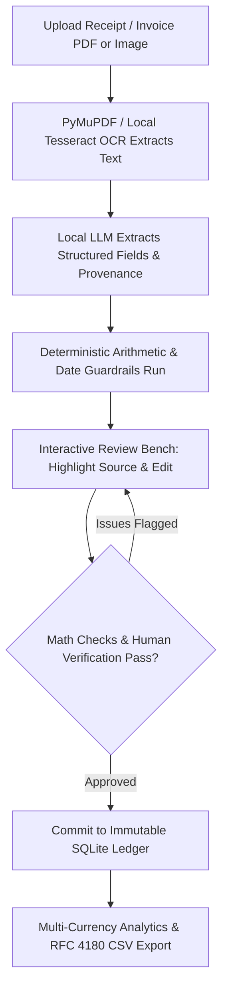
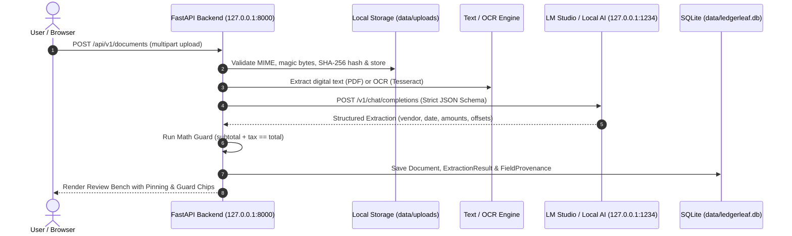
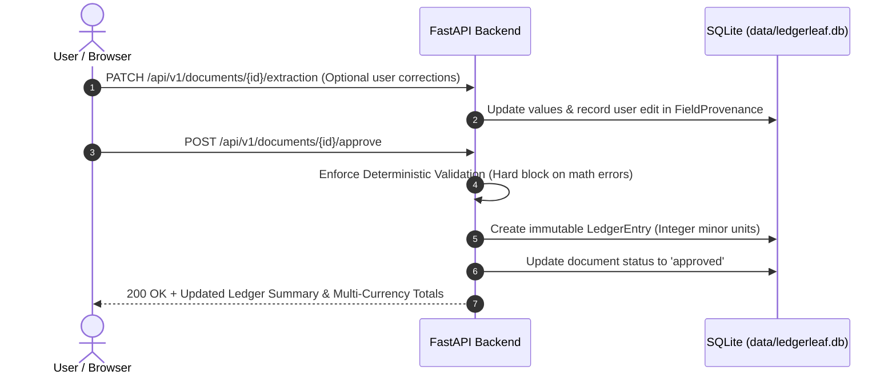

# LedgerLeaf

> A private, local-first financial document processing assistant. Open-weight AI extracts structured accounting records from messy receipts and invoices on your own device, guarded by deterministic verification and visual source provenance before anything touches your ledger.

[](#hacktoberfest--open-source-ai-challenge)
[](LICENSE)
[](#technical-details)
[](#technical-details)
[](#technical-details)

---

## Concept

Modern financial software forces freelancers, contractors, and small business owners into a bad trade-off: spend hours manually transcribing paper receipts into spreadsheets, or upload sensitive financial records, client names, and bank details to proprietary cloud APIs.

**LedgerLeaf** inverts this model:

> *"Your finances. Your files. Your AI."*

LedgerLeaf runs entirely on your local machine bound strictly to `127.0.0.1`. You drop in receipts or invoices (`.pdf`, `.png`, `.jpg`, `.webp`, `.txt`). A local open-weight model parses vendor details, invoice numbers, dates, currency, and line totals.

Crucially, **the AI proposes, but never dictates**. Every extracted amount links directly back to its verbatim character offset and line in the source document. Deterministic mathematical guards cross-check `subtotal + tax == total`. You review, correct any flagged discrepancies on the visual review bench, and approve the record into your persistent SQLite ledger with one click—exportable to clean, multi-currency RFC 4180 CSVs.

---

## Core Loop



---

## System Architecture

LedgerLeaf operates as a self-contained local application communicating exclusively over local loopback (`127.0.0.1`).

### Ingestion & Extraction Flow


### Review, Verification & Ledger Commit Flow


---

## Key Features

- **100% Local-First & Private:** All text extraction, OCR, database persistence, and LLM inference execute locally on `127.0.0.1`. No external APIs, cloud subscriptions, or remote analytics.
- **Visual Source Provenance:** Every parsed field links to its character offset and verbatim snippet in the source document. Clicking a field highlights its source location on the page.
- **Deterministic Arithmetic Guardrails:** Open-weight models can misread grainy receipts. Pure deterministic Python rules verify calculations (`abs(subtotal + tax - total) < 0.01`). The system flags math mismatches instead of silently falsifying numbers.
- **Integer Minor Units:** All monetary values are handled internally as integer minor units (cents, paise) with ISO 4217 currency codes to eliminate floating-point precision errors.
- **Strict Multi-Currency Isolation:** Ledger totals never merge EUR, USD, and INR into an arbitrary converted sum. Each currency balance is calculated and presented in its own ledger line.
- **Interactive Leaf Design System:** Custom responsive UI featuring leaf-vein canvas animations, accessible contrast tokens, light/dark themes, and instant keyboard shortcuts.
- **RFC 4180 CSV Export:** Exports cleanly formatted CSVs with proper field quoting and formula-injection defenses (`=`, `+`, `-`, `@` sanitization).

---

## Technical Details

| Component | Implementation | Description |
|---|---|---|
| **Backend** | [FastAPI](https://fastapi.tiangolo.com/) | High-performance asynchronous Python API server |
| **Database** | [SQLite](https://www.sqlite.org/) + [SQLAlchemy 2.0](https://www.sqlalchemy.org/) | ACID-compliant local database with schema migrations via Alembic |
| **Data Validation** | [Pydantic v2](https://docs.pydantic.dev/) | Strict typing, schema serialization, and request validation |
| **PDF Extraction** | [PyMuPDF / pypdf](https://pypdf.readthedocs.io/) | High-speed digital text layer and metadata extraction |
| **OCR Engine** | [pytesseract](https://pypi.org/project/pytesseract/) + [Pillow](https://python-pillow.org/) | Local optical character recognition for scans and image receipts |
| **Local AI Runtime** | [LM Studio](https://lmstudio.ai/) / [Ollama](https://ollama.com/) | Local OpenAI-compatible REST server on `127.0.0.1:1234/v1` |
| **AI Models** | Open-Weight LLMs | Tested with `llama-3.2-1b-instruct`, `gemma-3-4b`, `qwen3-8b` |
| **Frontend** | Vanilla JS (ES Modules) + CSS3 | No heavy Node build step; native procedural canvas leaf veins |
| **HTTP Client** | [HTTPX](https://www.python-httpx.org/) | Asynchronous communication between backend and local AI server |
| **Test Suite** | [Pytest](https://docs.pytest.org/) | Automated integration tests covering ingestion, guards, and ledger |

---

## Project Structure

```text
LedgerLeaf/
├── LedgerLeaf.html                # Original standalone leaf-themed prototype
├── requirements.txt               # Pinned Python dependencies
├── pytest.ini                     # Pytest configuration
├── alembic.ini                    # Alembic migration configuration
├── .env.example                   # Environment configuration template
├── .gitignore                     # Git rules (excludes secrets, uploads, SQLite DBs)
├── alembic/                       # Database schema versioning & migrations
│   ├── env.py                     # SQLite batch alter migration runner
│   └── versions/                  # Revision files
├── data/                          # Local runtime storage (git-ignored)
│   ├── ledgerleaf.db              # SQLite database file
│   ├── samples/                   # Synthetic receipt & invoice fixtures
│   └── uploads/                   # Secure original uploaded document files
├── frontend/                      # Web UI client application
│   ├── index.html                 # Semantic HTML5 application entry point
│   ├── assets/                    # Static brand assets
│   ├── css/
│   │   └── style.css              # Curated leaf design system, themes, and layout
│   └── js/
│       ├── api.js                 # Resilient multi-host FastAPI client module
│       ├── app.js                 # Review bench, field pinning, guards, and ledger
│       └── veins.js               # Canvas procedural leaf-vein animation
├── backend/                       # Python FastAPI application
│   ├── requirements.txt           # Backend requirements
│   ├── app/
│   │   ├── main.py                # FastAPI app, lifespan, CORS, and static mounting
│   │   ├── config.py              # Pydantic BaseSettings, directory management
│   │   ├── database.py            # SQLite engine, session maker, table creation
│   │   ├── api/v1/                # REST API endpoints
│   │   │   ├── health.py          # GET /api/v1/health
│   │   │   ├── ai.py              # GET /api/v1/ai/status, test-connection, models
│   │   │   ├── documents.py       # Ingestion, review, PATCH, validate, approve
│   │   │   ├── ledger.py          # Approved ledger, summaries, and CSV export
│   │   │   └── router.py          # Unified v1 router
│   │   ├── models/                # SQLAlchemy ORM models (Document, Extraction, Ledger)
│   │   ├── schemas/               # Pydantic schemas (Money, Document, Provenance)
│   │   └── services/              # Core business services
│   │       ├── storage_service.py # Path traversal defense & SHA-256 deduplication
│   │       ├── text_extraction_service.py # PDF parsing & Tesseract OCR
│   │       ├── local_ai.py        # LM Studio OpenAI-compatible client
│   │       └── validation_service.py # Deterministic math guards & date validators
│   └── tests/                     # 36 automated unit & integration tests
└── README.md                      # Project documentation
```

---

## Installation & Setup

### Prerequisites

1. **Python 3.10+** (Tested on Python 3.12).
2. **LM Studio** (or Ollama) running locally on your computer.
3. An active model loaded in LM Studio (e.g. `llama-3.2-1b-instruct`, `gemma-3-4b`, or `qwen3-8b`).
4. **Tesseract OCR (for scanned images and photo receipts):**
   - **Ubuntu / Debian:** `sudo apt-get update && sudo apt-get install -y tesseract-ocr`
   - **macOS:** `brew install tesseract`
   - **Windows:** Download from [UB-Mannheim Tesseract](https://github.com/UB-Mannheim/tesseract/wiki) and add to system `PATH`.
   *(Text-based PDFs and `.txt` documents work immediately without Tesseract).*

---

### 1. Clone & Set Up Virtual Environment

```bash
git clone https://github.com/Garg-Pankaj29/LedgerLeaf.git
cd LedgerLeaf

# Create and activate virtual environment
python3 -m venv .venv
source .venv/bin/activate       # Linux / macOS
# or: .venv\Scripts\activate   # Windows

# Install dependencies
pip install -r requirements.txt
```

---

### 2. Configure Environment

Copy the configuration template:

```bash
cp .env.example .env
```

Default `.env` settings:
```env
APP_NAME=LedgerLeaf
APP_ENV=development
DEBUG=True
HOST=127.0.0.1
PORT=8000

DATA_DIR=data
DATABASE_URL=sqlite:///./data/ledgerleaf.db
UPLOAD_DIR=data/uploads
MAX_UPLOAD_MB=15

# Security & CORS
CORS_ORIGINS=["http://localhost:8000","http://127.0.0.1:8000","http://localhost:3000","http://127.0.0.1:3000","null"]

# Local LM Studio / OpenAI-Compatible Server
AI_PROVIDER=lm_studio
AI_BASE_URL=http://127.0.0.1:1234/v1
AI_MODEL=llama-3.2-1b-instruct
AI_TIMEOUT_SECONDS=120
```

---

### 3. Start Local AI & Run LedgerLeaf

1. Open **LM Studio**, load your model (e.g. `llama-3.2-1b-instruct`), and start the **Local Server** on port `1234` with CORS enabled.
2. Start the FastAPI backend:

```bash
uvicorn backend.app.main:app --host 127.0.0.1 --port 8000 --reload
```

3. Open your browser to:
```
http://127.0.0.1:8000/app/
```
*(The top navigation badge will glow green with `● AI: <your-model-name>` indicating live local connection).*

---

## Usage Guide

1. **Access the Review Bench:** Open `http://127.0.0.1:8000/app/` in your browser.
2. **Upload a Receipt or Invoice:**
   - Click **＋ Upload** or drag a file (`.pdf`, `.png`, `.jpg`, `.webp`, `.txt`).
   - The file is securely saved to `data/uploads/`, and text/OCR extraction runs immediately.
3. **Automatic Local Extraction:** The local open-weight model extracts vendor, date, currency, line items, tax, and total.
4. **Inspect Source Provenance:**
   - Click any field in the right pane: the exact line where the number was found is highlighted in green on the original document text.
   - Click any highlighted snippet in the document view to jump to the corresponding input box.
5. **Deterministic Guard Verification:**
   - If `subtotal + tax != total`, a warning chip flags the arithmetic discrepancy.
   - If fields are unverified, you can edit them directly. Changes are recorded in field provenance history.
6. **Approve Record:**
   - Once the record is verified, click **Approve record**.
   - The entry is committed to your permanent SQLite ledger as integer minor units.
7. **View Ledger & Export CSV:**
   - Scroll down to the **Approved ledger** section to view isolated currency breakdowns.
   - Click **Build CSV of approved records** to export or copy RFC 4180 compliant accounting summaries.

---

## Design Philosophy

- **AI Proposes, Deterministic Code Guards, Humans Decide:** Language models are probabilistic pattern matchers, not accountants. LedgerLeaf treats model outputs as untrusted proposals until verified by strict math rules and reviewed by a person.
- **Privacy Is Binary:** Financial paperwork should not be processed by remote cloud endpoints. By running models locally through open-weight architectures, data privacy is absolute.
- **Line-Level Traceability:** A financial tool should never present a number without proving where it originated. Source pinning eliminates guesswork.
- **Strict Multi-Currency Isolation:** Currencies must never be arbitrarily converted or merged without explicit currency rates. Each currency maintains its own independent balance.

---

## Open Innovation & Local-First AI

LedgerLeaf showcases why open-source AI and open-weight models are vital for real-world software:

- **True Data Sovereignty:** Personal tax documents and receipts never leave `127.0.0.1`. No training on your financial records.
- **Zero Metered Costs:** Freelancers and small businesses can parse thousands of documents without incurring API rate limits, per-token billing, or recurring SaaS fees.
- **Model Flexibility:** Swap between `llama-3.2-1b-instruct`, `gemma-3-4b`, or larger models without altering a single line of backend logic.
- **Perpetual Availability:** LedgerLeaf operates completely offline once dependencies and model weights are downloaded.

---

## Hacktoberfest & Open-Source AI Challenge

LedgerLeaf was developed for the **Hacktoberfest 2026 Open-Source AI Challenge** under the **Side Hustle** category.

It addresses a universal problem for independent creators, freelancers, and side hustlers: transforming shoeboxes of messy receipts into verified, audit-ready bookkeeping records with zero recurring SaaS costs and zero privacy compromises.

---

## Running the Automated Test Suite

LedgerLeaf includes a comprehensive test suite of 37 automated tests verifying database initialization, duplicate detection, arithmetic validation guards, CSV escaping, and offline AI resilience:

```bash
# Run test suite
pytest
```

Expected output:
```text
36 passed, 1 skipped in 0.79s
```
*(The skipped test is the live LM Studio integration check, which executes automatically when LM Studio is running).*

---

## Known Limitations

- **OCR Quality on Degraded Receipts:** Faded thermal receipts or blurry camera angles may require manual field adjustment on the review bench.
- **Single-Node Local SQLite:** Optimized for local, single-user operation on a personal laptop or workstation.
- **Document Scope:** Built as an intelligent review and ingestion assistant; does not replace certified tax advisors or double-entry accounting software.

---

## Future Directions

- Multi-page PDF visual overlay highlighting directly onto rendered canvas pages.
- Native bank statement (`.ofx` / `.qif`) reconciliation matching.
- Mobile companion camera helper over local Wi-Fi.
- Automated tax category deduction suggestions based on country-specific expense rules.

---

## Contributing

Contributions, feedback, and issue reports are welcome:

1. Fork the repository.
2. Create your feature branch (`git checkout -b feature/amazing-feature`).
3. Commit your changes (`git commit -m "feat: add support for multi-page canvas overlays"`).
4. Push to the branch (`git push origin feature/amazing-feature`).
5. Open a Pull Request.

---

## License

This project is licensed under the MIT License — see the [LICENSE](LICENSE) file for details.
